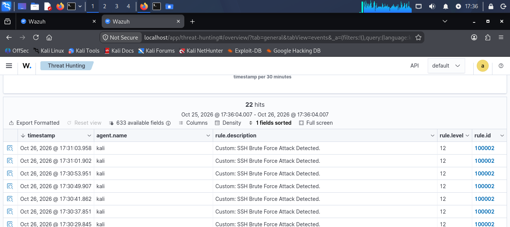

# Incident Report: ssh-brute-force

**Report ID:** IR-01  
**Date:** 2026-10-26  
**Analyst:** Lekhraj Dheerani  

## 1. Executive Summary
On October 26, 2026, a simulated SSH brute-force attack was executed against the localhost (Kali Linux) targeting the SSH service. The Wazuh SIEM successfully detected the attack using custom rule 100002, generating a high-severity alert after observing 5 consecutive failed login attempts within 60 seconds. No successful unauthorized access was gained, and the activity was logged for further analysis.
## 2. Attack Details
| Field | Value |
|-------|-------|
| Attack Type | SSH Brute Force |
| Source IP | 127.0.0.1 (Localhost) |
| Target | Kali Linux (localhost) |
| Port | 22 ssh|
| Duration | 20 seconds |
| Attempts | 20 |

## 3. Detection
**Rule ID:** 100002 
**Rule Level:** 12 
**Rule File:** `local_rules.xml`  
**MITRE ATT&CK:** T1110  

### Rule Logic
<rule id="100001" level="10">
  <if_sid>5710</if_sid>
  <description>Custom: SSH Failed Login Attempt Detected.</description>
  <mitre>
    <id>T1110</id>
  </mitre>
</rule>

<rule id="100002" level="12" frequency="5" timeframe="60">
  <if_matched_sid>100001</if_matched_sid>
  <description>Custom: SSH Brute Force Attack Detected (5 failed logins in 60s).</description>
  <mitre>
    <id>T1110</id>
  </mitre>
</rule>
## 4. Evidence

