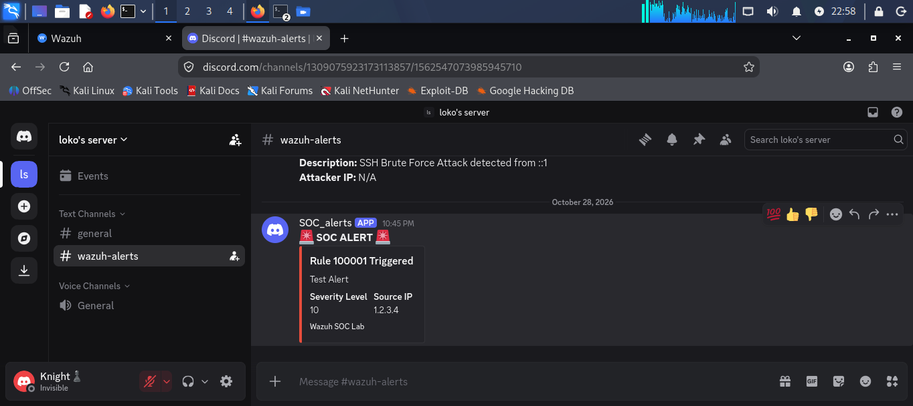

# Incident Report: Discord Real-Time Alerting

**Report ID:** IR-05  
**Date:** 2026-10-28  
**Analyst:** Lekhraj Dheerani  

## 1. Executive Summary
On October 28, 2026, a real-time alerting mechanism was implemented by integrating Wazuh SIEM with Discord via a custom Webhook. The objective was to ensure that SOC analysts receive instant notifications for high-severity incidents (Level 8+). The integration was tested by simulating an SSH brute-force attack, which triggered the custom detection rule (100001). The custom Python script successfully formatted the alert and pushed it to the Discord channel, providing the Rule ID, Description, and Source IP in real-time.

## 2. Attack Details
| Field | Value |
|-------|-------|
| Attack Type | SSH Brute Force |
| Source IP | 127.0.0.1 |
| Target | Kali Linux (localhost) |
| Trigger Rule | 100001 (Level 10) |
| Notification Channel | Discord (SOC_alerts) |

## 3. Detection & Alerting
**Rule ID:** 100001  
**Rule Level:** 10  
**MITRE ATT&CK:** T1110  

### Integration Logic
- **Script:** `custom-discord.py`
- **Trigger:** Wazuh executes the script on Level 8+ alerts.
- **Action:** Sends a JSON payload to the Discord Webhook URL.
- **Payload:** Includes Rule ID, Description, Severity Level, and Source IP.

## 4. Evidence

