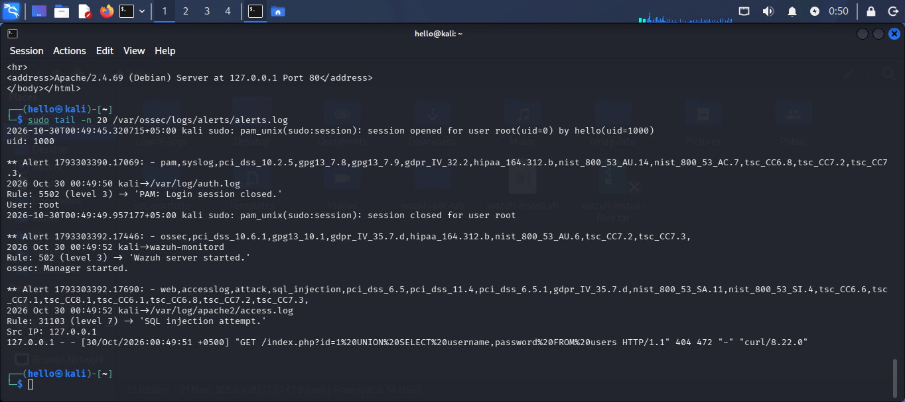

# Incident Report: web-sqli

**Report ID:** IR-06  
**Date:** 2026-10-30  
**Analyst:** Lekhraj Dheerani  

## 1. Executive Summary
On October 30, 2026, a simulated SQL Injection (SQLi) attack was executed against the local Apache2 web server running on localhost. The Wazuh SIEM successfully detected the attack using its built-in web attack ruleset. The malicious request containing a UNION SELECT payload was captured in the Apache `access.log` file. Wazuh Rule 31103 (Level 7) triggered within seconds, mapping to MITRE ATT&CK T1190 (Exploit Public-Facing Application). The attack returned a 404 (Not Found) response, indicating the target page did not exist; however, the detection mechanism was verified as fully functional.

## 2. Attack Details
| Field | Value |
|-------|-------|
| Attack Type | SQL Injection (SQLi) |
| Payload | `id=1 UNION SELECT username,password FROM users` |
| Source IP | 127.0.0.1 (Localhost) |
| Target | Apache2 Web Server (Port 80) |
| HTTP Method | GET |
| Response Code | 404 (Not Found) |
| Detection Time | < 2 seconds |

## 3. Detection
**Rule ID:** 31103  
**Rule Level:** 7  
**Rule File:** `web_appsec_rules.xml` (built-in)  
**MITRE ATT&CK:** T1190 (Exploit Public-Facing Application)  

### Detection Logic
Wazuh monitors `/var/log/apache2/access.log`. When a request matches known SQL injection patterns (e.g., `UNION SELECT`), Rule 31103 triggers.

## 4. Evidence

